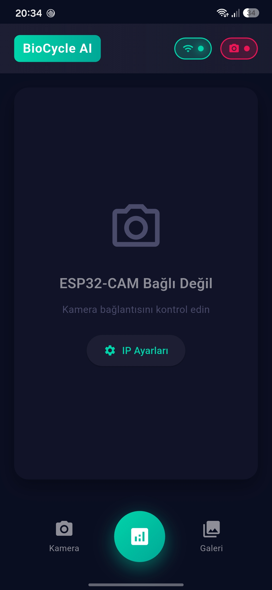
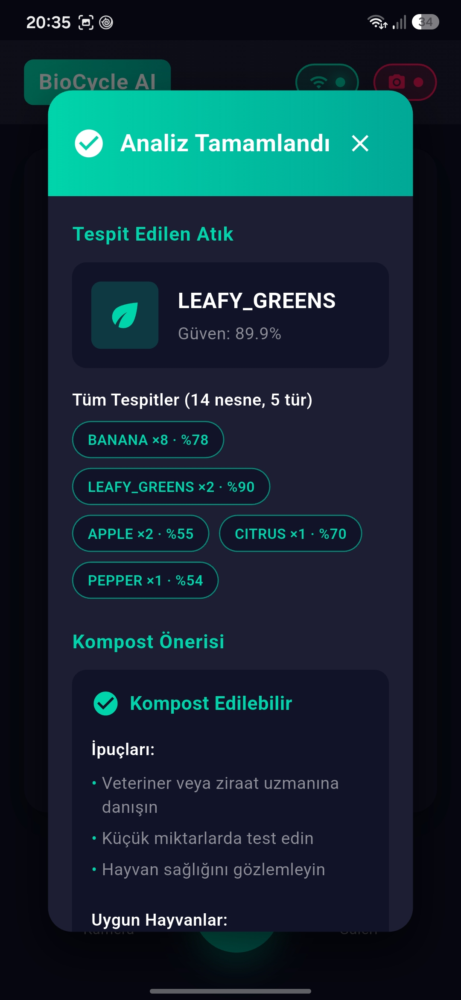
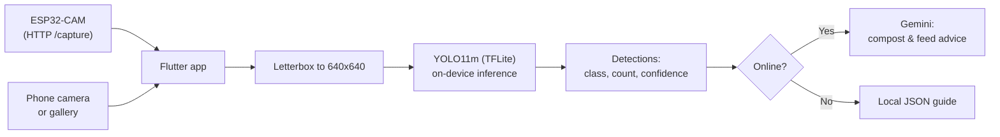
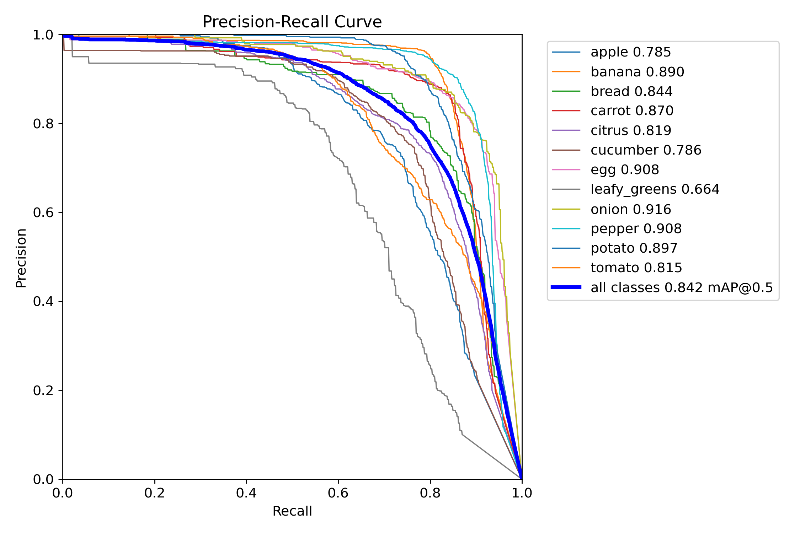
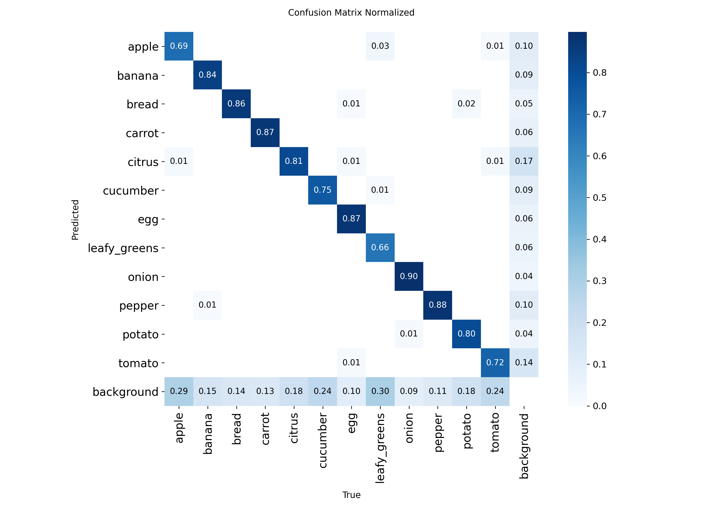
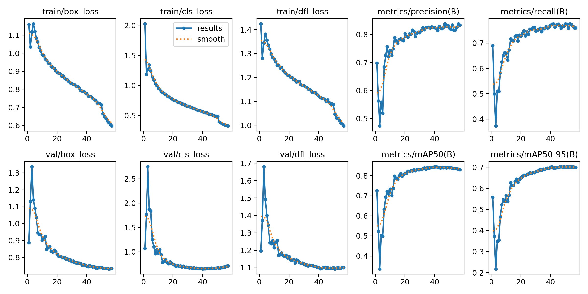

# BioCycle AI — On-Device Organic Waste Detection with YOLO11

Flutter app that detects organic food waste in a photo **on the device** with a custom-trained **YOLO11m** model, then gives composting and animal-feed advice with **Google Gemini**. Images can come from an **ESP32-CAM** over Wi-Fi or from the phone's camera and gallery.

Built by a 3-person team at Dokuz Eylül University (Computer Engineering).

<table>
  <tr>
    <td align="center"><br /><sub><b>Home</b></sub></td>
    <td align="center"><br /><sub><b>Detection result</b></sub></td>
  </tr>
</table>

## How It Works



1. **Image input:** from the ESP32-CAM's `/capture` endpoint on the local network, or from the phone's camera or gallery.
2. **Preprocessing:** the image is letterboxed to 640×640 (aspect ratio kept, gray padding), the same way the model was trained.
3. **Detection:** YOLO11m runs on the phone with TensorFlow Lite. No server is needed.
4. **Results:** every detected item is listed with its count and best confidence, e.g. `BANANA ×8 · %78`.
5. **Advice:** with internet, Gemini acts as an agronomist/veterinarian and returns compost or animal-feed advice, including warnings for foods toxic to animals. Offline, the app falls back to a local JSON guide.

## Model

The detector is a **YOLO11m** model (20M parameters) trained with Ultralytics on Google Colab (NVIDIA A100) on a custom Roboflow dataset of organic kitchen waste.

**Classes (12):** apple, banana, bread, carrot, citrus, cucumber, egg, leafy greens, onion, pepper, potato, tomato

**Best validation results** (3,337 images, 10,687 labeled objects):

| Metric | Value |
|---|---|
| mAP@50 | **0.842** |
| mAP@50-95 | **0.703** |
| Precision | 0.838 |
| Recall | 0.759 |

The model went through 13 training iterations, starting from YOLOv8n on an 8-class dataset and ending with YOLO11m on the current 12-class dataset, with early stopping (patience 10). It was exported to TFLite for on-device use.

The full training, evaluation and export pipeline is in [`training/train_yolo11.ipynb`](training/train_yolo11.ipynb).

<table>
  <tr>
    <td align="center"><br /><sub><b>Precision-recall curve per class</b></sub></td>
    <td align="center"><br /><sub><b>Normalized confusion matrix</b></sub></td>
  </tr>
</table>

<details>
<summary>Training curves (loss, precision, recall, mAP per epoch)</summary>


</details>

The weakest class is **leafy greens** (mAP@50 0.66): loose leaves have no fixed shape and are often confused with the background. The strongest classes are onion, egg and pepper (mAP@50 0.91–0.92).

## My Role

- Co-trained the YOLO11 model: dataset iterations, training runs and evaluation on Colab
- Developed the Flutter app: TFLite inference pipeline, ESP32-CAM integration, Gemini advice service and the UI

## Tech Stack

| Area | Technologies |
|---|---|
| Mobile | Flutter, Dart, Riverpod, get_it + injectable, Dio |
| On-device ML | tflite_flutter, image (letterbox preprocessing) |
| Model training | Ultralytics YOLO11, Roboflow, Google Colab |
| LLM | Google Gemini (`google_generative_ai`) |
| IoT | ESP32-CAM (HTTP image capture and stream) |
| Architecture | Clean Architecture: data / domain / presentation layers |

## Project Structure

```
lib/
├── core/            # Constants, dependency injection, error types
├── data/
│   ├── datasources/ # TFLite detection, ESP32-CAM, image picker, Gemini, offline advice
│   ├── models/
│   └── repositories/
├── domain/          # Entities, repository interfaces, use cases
└── presentation/    # Dashboard, result dialog, Riverpod providers
assets/
├── models/best.tflite   # YOLO11m TFLite export
└── data/waste_guide.json  # Offline advice
training/
├── train_yolo11.ipynb   # Colab notebook: dataset, training, evaluation, TFLite export, Gemini advice
└── results/             # Training plots of the final run
```

## Getting Started

**Requirements:** Flutter SDK (Dart 3), an Android device or emulator.

```bash
flutter pub get
flutter run
```

**Gemini advice (optional):** set your API key in `lib/core/constants/app_constants.dart` (`geminiApiKey`). Do not commit a real key. Without a key, the app uses the offline advice guide.

**ESP32-CAM (optional):** the camera must expose `/capture` (JPEG) and `/stream` endpoints over HTTP. Enter its IP address from **IP Settings** in the app. Without an ESP32-CAM, use the **Camera** and **Gallery** buttons.

## Known Limitations

- The model only recognizes the 12 classes above. Other foods (for example mushrooms or pineapple) are not detected.
- Compost advice is generated for the most confident detection, not for the whole mix.
- The ESP32-CAM firmware is not part of this repository.

---

Developed at Dokuz Eylül University, Department of Computer Engineering.
